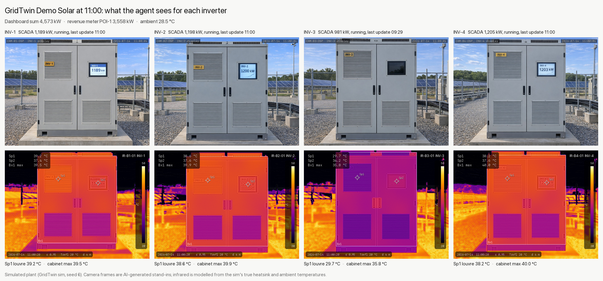

# s06 case pack (simulated): sensor, camera and infrared data for "find what is wrong"

This is the data an agent gets at 11:00 in scenario `s06_stale_scada`, to find out why revenue is down while the dashboard looks fine.
Everything in it is simulated, so present it as "simulated" on stage.



## How the demo uses it

1. Stage the agent's folder outside the repo, so it never sits next to the answer key: `.venv/bin/python -m scripts.make_s06_case --stage /tmp/s06`.
   Start the agent in `/tmp/s06` with `agent/PROMPT.md` as its task.
2. The agent has to cross-check three sources to find INV-3: sensors, camera and infrared.
3. The twin labels INV-3 in the Gaussian splat and pulls its data through `agent/objects.json`, which has one entry per inverter with its latest SCADA reading and file paths.
4. Grade the agent's answer against `answer_key/finding.json`.

## The case

<!-- case:start -->
- 09:30: INV-3's comms card dies, and the inverter safe-stops at 0 kW.
  SCADA keeps showing its last report (980.75 kW, running, heatsink 32.1 C, fan 2386 rpm) with `last_update` stuck at 09:29, and no alarm is raised.
- 11:00: the dashboard adds up to 4,573 kW, while the revenue meter POI-1 reads 3,558 kW, a gap of about one inverter.
- Camera at 11:00: INV-3's display is dark, while INV-1, INV-2 and INV-4 are lit and show their output.
- Infrared at 11:00 (ambient 28.5 C): INV-3's upper louvre reads 29.7 C and its cabinet max is 35.8 C.
  On the running units, the louvre reads 38.2 to 39.2 C and the cabinet max 39.5 to 40.0 C.
  INV-3 is making no heat, so it is converting no power, whatever SCADA says.
- Energy lost from 09:30 to 11:00 is 1.64 MWh ($73.96 at $45/MWh), counting INV-3 as the mean of INV-1, INV-2 and INV-4 each minute; graders accept 1.45 to 1.75 MWh.
- The fix is to open 52-I3 and reseat INV-3's comms card (work order `reseat_comms_card`, 45 minutes, $900).
<!-- case:end -->

## Files

| Path | Seen by the agent | Contents |
|---|---|---|
| `agent/PROMPT.md` | yes | the task |
| `agent/DATA.md` | yes | what every file and column means |
| `agent/sensors/scada_1min.csv` | yes | SCADA as reported, 09:01 to 11:00, per minute: meter, met station, and per inverter ac_kw, dc_kw, dc_v, heatsink_c, fan_rpm, status, last_update |
| `agent/sensors/alarms.json` | yes | active alarms and alarms since 09:00 (none) |
| `agent/camera/INV-n_display.jpg` | yes | fixed display camera per inverter, 1024x768, 11:00:04 |
| `agent/infrared/INV-n_ir.png` | yes | thermal frame per inverter, ironbow, span locked at 20 to 50 C, spot meters Sp1 (louvre) and Sp2 (display), box Bx1 (cabinet) |
| `agent/infrared/INV-n_ir.csv` | yes | radiometric data, 240x320, deg C |
| `agent/objects.json` | yes | per-inverter index for the twin: block, breaker, latest SCADA, file paths, infrared readings |
| `agent/work_orders.json` | yes | the contractor's work-order catalogue (all eight), with time, cost and de-energize flag |
| `answer_key/finding.json` | no | failed asset, failure, what it failed to be, evidence per source, cost so far with an accepted range, fix |
| `answer_key/hidden_truth.csv` | no | what each inverter really did each minute |
| `answer_key/provenance.json` | no | where each piece of data came from, with the image prompts |
| `_src/` | no | the generated camera photos and their prompts |
| `overview.png` | no | camera over infrared for all four units, for people |

## Where the data comes from

- Sensors: the GridTwin simulator, scenario `s06_stale_scada`, seed 6, run to 11:00 with no model calls.
  Each fresh SCADA report carries small sensor noise (0.1% on kW, 0.6 V, 0.12 C, 10 rpm, gusty wind), and a held report repeats exactly, as a frozen tag does.
  `answer_key/hidden_truth.csv` has the sim's own values.
- Camera: OpenAI `gpt-image-1.5` edits of the photo-bank pictures of the INV-3 cabinet (`assets/photos/INV-3/`).
  Each unit has its own tag, and each lit display shows that unit's real sim output.
  These are AI-generated stand-ins, not photographs of a real plant.
- Infrared: modelled by `scripts/make_s06_case.py` on each camera frame, not taken by a thermal camera.
  Cabinet parts are found in each photo, then given temperatures from the sim's true heatsink and ambient values at 11:00.
  The exhaust louvres and grilles carry the inverter's heat but stay below its heatsink temperature, the skin is warmed by the sun plus the cabinet's own losses, and the display glass is warmed by the sun, more so when its backlight is on (the LCD's content is not in the radiometric data).
  The background is sky (cold), vegetation (near ambient), PV modules (warm), and sunlit surfaces heated by how dark they are.
  The render adds the camera's edges (MSX style), 50 mK sensor noise and the optics' blur.

## Regenerate

```bash
.venv/bin/python -m scripts.make_s06_case
```

That takes about 3 seconds and needs no network; it reuses the photos in `_src/`.
To make new photos (about $1 of OpenAI image edits), run `.venv/bin/python -m scripts.gen_s06_case_photos` first, with `OPENAI_API_KEY` set or `GRIDTWIN_ENV_FILE` pointing at an env file that has it.
The test is `tests/sim/test_s06_case.py`.
