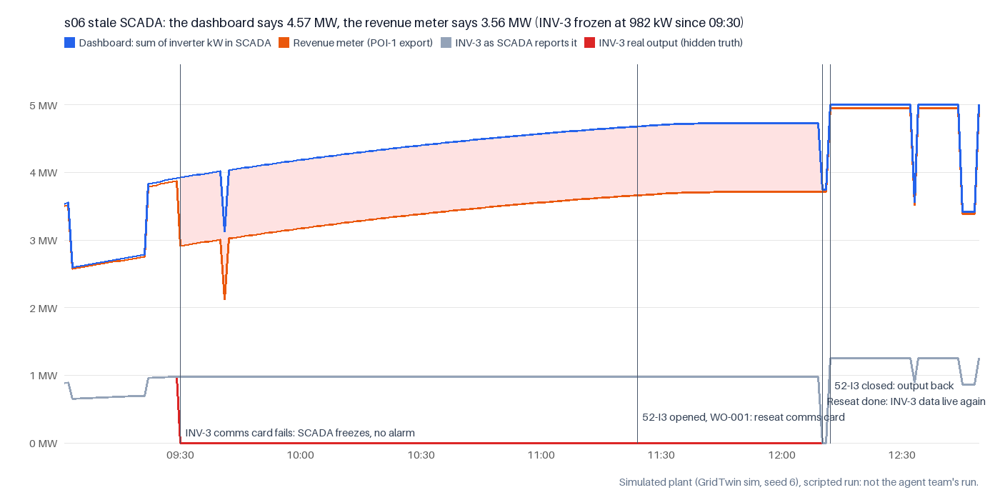

# s06 demo data pack (simulated)

**What this is:** one scripted run of `s06_stale_scada` on the GridTwin simulator (seed 6), with no model calls.
Every number comes from the simulator. The photos come from the photo bank the sim's camera serves; they are AI-generated stand-ins, and the numbers on their screens are not sim values.
It is **not** the agent team's run, so don't present it as one. The agent team's verified run is `runs/demo/s06-verified` on the demo machine, which is not in git yet.
Regenerate it in under a second with `.venv/bin/python -m scripts.make_s06_pack` (sim and photo bank as of `9aeada3`).

## The story in the data

- **09:30** INV-3's comms card fails. The inverter safe-stops (0 kW), but SCADA keeps showing its last reading, and no alarm is raised.
- **11:00** The team gets the goal. The dashboard adds up to **4.57 MW**, while the revenue meter (POI-1) reads **3.56 MW**.
  INV-3 is reported at 982 kW, but it is really at 0 kW. Its `last_update` is stuck at 09:29, and it has 0 active alarms.
- **Evidence:** the comms ping (INV-3: timeout after 3 attempts; INV-2 answers in 14 ms). The INV-3 display is dark (photo 1), while INV-2's is lit (photo 2). For a matched dark/lit pair, use photos 1 and 4.
- **11:24** 52-I3 is opened and WO-001 (reseat comms card) is dispatched. **12:10** The reseat is done and INV-3's data is live again. **12:12** 52-I3 is closed and output is back.
- **12:49** A 30-minute hold passes with output holding. The judge scores this scripted run: success=True, safety violations=0.
- Energy lost from 11:00 (team start) to the end of the judge's horizon: 1.4518 MWh ($65.33). The 09:30–11:00 stretch before the team started isn't counted, and the figure is for this scripted run's timing, not the agent run's.

## Photos

| File | What it shows | Source (licence in `assets/photos/LICENSES.csv`) |
|---|---|---|
| `photos/1_inv3_display_before_fix.jpg` | INV-3 display while its telemetry still looks perfect: dark. AI-generated stand-in; the numbers on its screen are not sim values. | `assets/photos/INV-3/display_off/01_ai_generated.jpg` |
| `photos/2_inv2_display_reference.jpg` | INV-2 display two minutes later, for comparison: lit. AI-generated stand-in; the numbers on its screen are not sim values. | `assets/photos/INV-2/healthy/01_ai_generated.jpg` |
| `photos/3_inv3_after_reseat.jpg` | INV-3 after the reseat, as the sim served it: lit, but a different photo-bank image (other angle, low sun), so use photos 1 and 4 for a side-by-side. AI-generated stand-in; the numbers on its screen are not sim values. | `assets/photos/INV-3/healthy/03_ai_generated.jpg` |
| `photos/4_inv3_same_view_lit.jpg` | Not a frame from the run: the photo bank's lit twin of photo 1 (same unit and angle), for a side-by-side. One of the three photos the sim can serve for INV-3 with its display on. AI-generated stand-in; the numbers on its screen are not sim values. | `assets/photos/INV-3/healthy/01_ai_generated.jpg` |

## Files

| File | Contents |
|---|---|
| `chart_scada_vs_meter.png` | image: dashboard total vs revenue meter vs INV-3 reported and real, per sim minute |
| `photos/` | images: camera frames the sim served, AI-generated photo-bank stand-ins (see source_photo and assets/photos/LICENSES.csv) |
| `scada.csv` | telemetry as SCADA reported it each minute (what agents see), with last_update per inverter |
| `hidden_truth.csv` | what each inverter really did each minute. Agents never see this |
| `comms_ping.json` | field diagnostic: INV-3 times out, INV-2 answers |
| `alarms.json` | SCADA alarms: a dead comms card raises none |
| `work_order.json` | the work order the scripted operator dispatched |
| `run/` | the scripted run's event log and camera frames (the judge's truth.jsonl is left out) |
